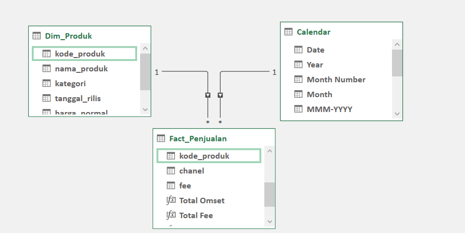
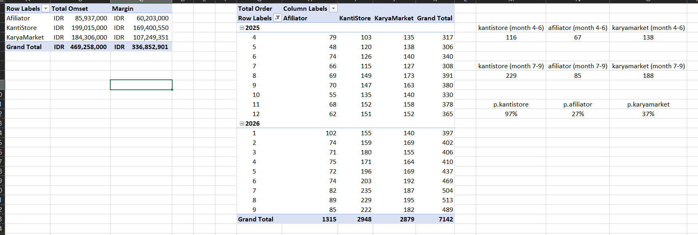

# Digital Product Sales Consolidation (Kanti Studio)

## Business Problem

Kanti Studio (a fictional business) sells digital products (ebooks and templates) through 3 channels at once: its own store (KantiStore), a third-party marketplace (KaryaMarket), and an affiliate program. The problem is that the sales data from the three channels comes in different formats and has never been combined, so the owner cannot answer a simple question like "which channel is actually the most profitable?" without first merging and cleaning the data.

This project consolidates the raw data from those 3 sources into a single Excel data model, then answers 6 key business questions about revenue, margin, and growth trends per channel.

*Note: all data in this project is simulated (synthetic), designed to resemble real business patterns. It is not real company data.*

## Approach

1. **Power Query.** The 3 raw sources (KantiStore, KaryaMarket, Afiliator) are each cleaned in a separate query: remove duplicates, filter out transactions whose status is not "Completed" (refunds/chargebacks), standardize date formats, and map messy product names (inconsistent capitalization, some without spaces) to consistent product codes using a mapping table.
2. The three clean queries (`Fact_KantiStore`, `Fact_KaryaMarket`, `Fact_Afiliator`) are combined into a single `Fact_Penjualan` (sales fact) table with Append Queries, after aligning the column schema across all three (date, product code, qty, revenue, fee, channel) so they can be combined safely.
3. **Power Pivot.** `Fact_Penjualan` is linked to `Dim_Produk` (product price and production cost) and a Calendar table through relationships, so every channel can be analyzed in one model.
4. **PivotTables and DAX measures** answer the 6 business questions: revenue contribution per channel, the effect of uncleaned data on the channel ranking, net margin per channel, the effect of misreading the affiliate commission format, monthly growth trends, and a recommendation on which channel is most worth pushing.

## Key Formulas/Features

- `Margin := SUM(Fact_Penjualan[omzet]) - SUMX(Fact_Penjualan, RELATED(Dim_Produk[biaya_produksi])) - SUM(Fact_Penjualan[fee]))`. A DAX measure for net margin per channel, calculated row by row because production cost differs per product.
- `Total Order := COUNTROWS(Fact_Penjualan)`. Used with the Calendar table to see the monthly order count trend per channel.
- A Power Query custom column, in two versions for comparison: `if [komisi_tercatat] > 30 then 30 else [komisi_tercatat]` (the wrong version, forcing everything to a percentage) vs. `if [komisi_tercatat] <= 30 then [nilai_penjualan] * [komisi_tercatat] / 100 else [komisi_tercatat]` (the correct version). Used to prove the effect of misreading the affiliate commission format (percentage vs. nominal rupiah).
- Group By (Advanced mode, with no grouping column). Used as a safe way to calculate aggregate totals without changing the original table.

*Note: the worksheet is named `Fact_Sales`, while the Power Query and Data Model table keeps its original name `Fact_Penjualan`, which is the name used in the DAX measures above.*

*Column and table names (`omzet` = revenue, `biaya_produksi` = production cost, `komisi_tercatat` = recorded commission, `nilai_penjualan` = sales value) are in Indonesian, matching the source data.*

## Screenshots

**Data Model (Power Pivot):** `Fact_Penjualan` is linked to `Dim_Produk` and a Calendar table, each one-to-many.

**PivotTables:** total revenue and margin per channel (left), monthly order count per channel (middle), and the average monthly orders for the first 3 and last 3 months with the growth used in the trend finding (right).

## Findings

After the data from the 3 channels was cleaned and consolidated, total revenue came to Rp469,258,000, with KantiStore contributing 42.4% (Rp199,015,000), KaryaMarket 39.3% (Rp184,306,000), and Afiliator 18.3% (Rp85,937,000).

The most important finding: if KaryaMarket revenue is summed straight from the raw data without filtering transaction status, the result is Rp204,858,000, higher than KantiStore, which makes KaryaMarket look like the biggest channel. Once Refunded and Chargeback transactions (9.6% of all transactions) are excluded, its revenue drops to Rp184,306,000 and the ranking flips to below KantiStore. This is concrete proof of why data must be cleaned before drawing business conclusions.

On margin, the gap is even clearer. KantiStore has a margin ratio of 85.1% while KaryaMarket has only 58.2%, even though their revenue is similar. KaryaMarket's large fee (around 30%) plus a high refund rate make it far less profitable than the gross revenue figure suggests.

For the Afiliator channel, how the commission format is read also has a significant effect. Commission calculated correctly (following each row's original format, percentage or nominal rupiah) comes to Rp15,529,500, while forcing every row to be calculated as a percentage gives Rp19,097,100, 23% more than it should be.

On trend, KantiStore is also growing fastest. Average monthly orders rose from about 116 to about 229 (up 97%) between the first 3 months and the last 3 months, far above KaryaMarket (up 37%) and Afiliator (up 27%).

In conclusion, three different angles (net revenue, margin, and growth trend) all point to KantiStore as the channel most worth pushing next year, not KaryaMarket, whose raw revenue looks the biggest.

## How to View

The final Excel file is in the `data/` folder together with the 4 raw data files it is built from. Download the `.xlsx` file and open it in Excel (the Power Pivot add-in must be enabled to see the data model and measures). To enable it: File > Options > Add-ins > COM Add-ins, then check "Microsoft Power Pivot for Excel".
