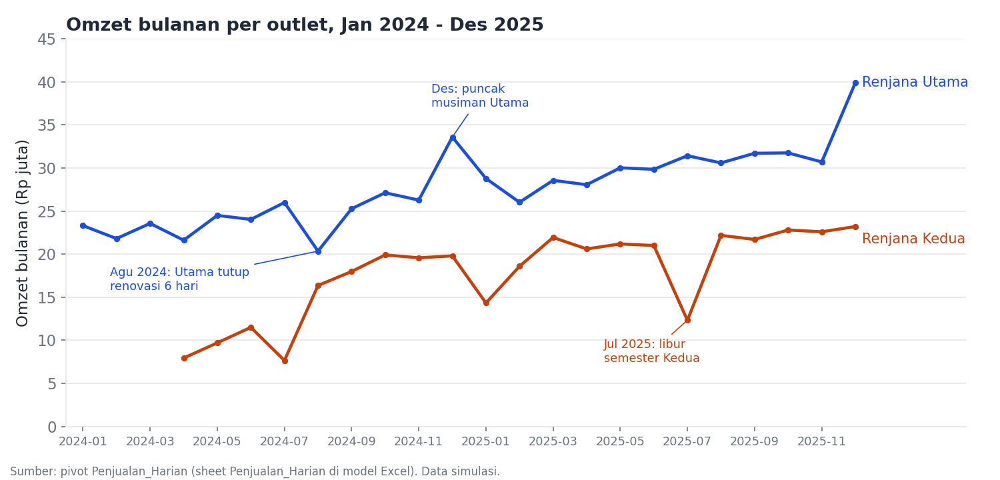
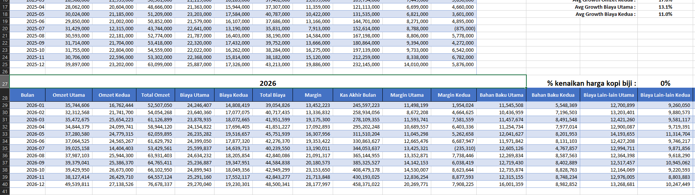
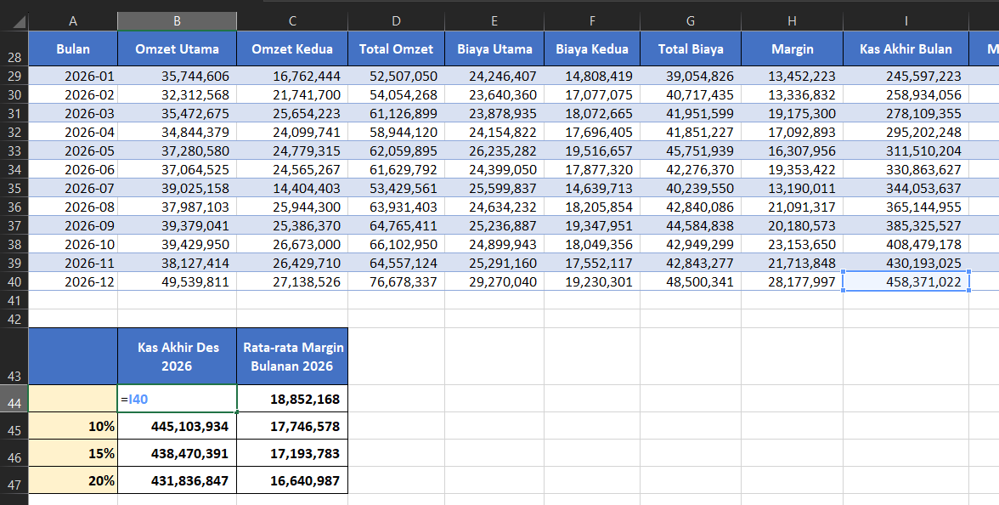
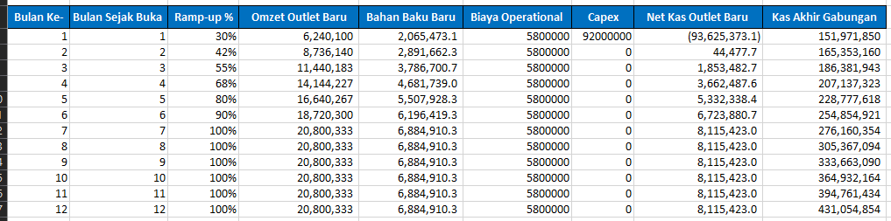
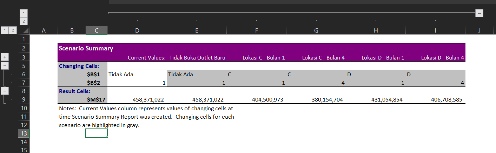
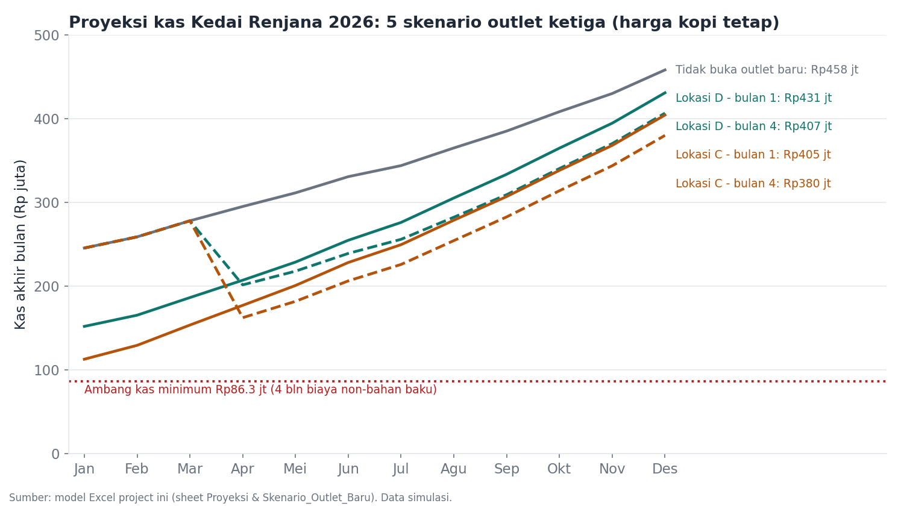
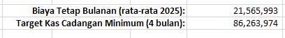
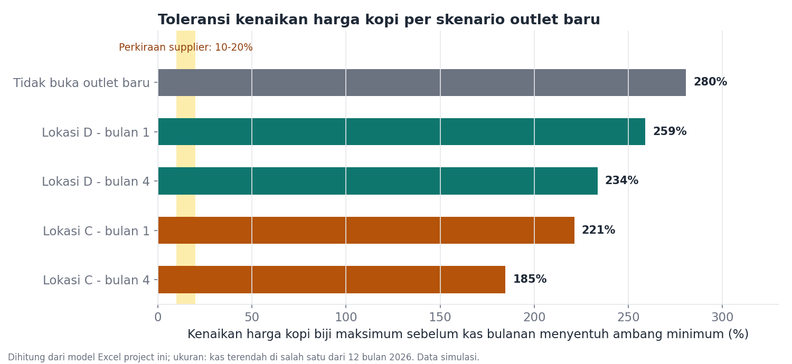

# Kedai Renjana Budget & Cash Flow Planning

An Excel cash planning model (Data Table, Scenario Manager, Goal Seek) for a 2-outlet coffee shop that has to make two decisions at once: how to handle a rise in coffee bean prices, and whether to open a third outlet without a bank loan.

## Business Problem
Kedai Renjana is a small coffee shop with two outlets (Renjana Utama since June 2022, Renjana Kedua since April 2024). Its regular coffee bean supplier is going to raise prices by roughly 10-20% (not yet certain), and at the same time the owner, Kirana, is weighing two locations for a third outlet: Location C (near the train station) and Location D (near a residential area). The new outlet must be funded 100% from the shop's own cash, and Kirana has no benchmark yet for how much cash reserve counts as safe.

The questions this model answers: which location and opening month is easiest on cash, when the investment pays back, and how large a coffee price increase the business can absorb if everything happens at once. The model is built so Kirana (who is not a finance person) can change the assumptions herself and see the results immediately.

## Screenshots

**24-month revenue pattern (BQ1)**



**2026 baseline projection (BQ3)**: revenue, costs, margin, and month-end cash for January-December 2026.



**Data Table: coffee bean price increase simulation (BQ4)**: December ending cash and average monthly margin for increases of 10%, 15%, and 20%. The top figure (no increase) is the baseline.



**New outlet model (BQ5)**: an example with Location D opening in month 1. The ramp-up curve, capex, and combined cash are calculated month by month.



**Scenario Manager: 5 scenarios in one table (BQ5)**



**2026 cash for all five scenarios against the minimum cash threshold (BQ5-BQ6)**: this chart is generated from the model's numbers.



**Minimum cash threshold (BQ6)**



**Goal Seek: finding the maximum coffee price increase (BQ6)**: cell `Proyeksi!O27` after Goal Seek has run.


**Coffee price increase tolerance per scenario (BQ6)**: this chart is generated from the model's numbers.



## Approach
1. **Clean the data.** The daily revenue and monthly costs of both outlets have four deliberately realistic problems: the transaction count was blank for 5 days because the cash register broke, 6 days closed for renovation were recorded as revenue 0, 3 duplicate rows came from the cash register system transition, and rent was wrongly booked under "Lain-lain" (Other) in two months. All of them were handled before use.
2. **Summarize into a monthly table** with `SUMIFS` and PivotTables, then calculate the margin per outlet and the running cash balance from the starting cash of Rp12 million (1 January 2024).
3. **2026 baseline projection**: each month's revenue and costs in 2026 = the same month in 2025 multiplied by each outlet's average annual growth.
4. **Stress test with three what-if tools**: a Data Table for coffee price sensitivity, Scenario Manager to compare locations and opening months, and Goal Seek to find the tolerance point for the combination of both.

## Key Formulas/Features
- `=B14*(1+$O$15)` (sheet `Proyeksi`): used to project January 2026 revenue from January 2025 using the outlet's average annual growth (24.2% Utama, 17.0% Kedua).
- `=N29 + L29*(1-55%) + L29*55%*(1+$O$27)` (the Biaya Utama Akhir column, i.e. Utama final cost): used to raise only the coffee bean portion (55% of raw materials) by the percentage in input cell `O27`, while other costs stay unchanged. The base cost column is kept separate from the "Akhir" (final) column so the baseline stays intact and there is no circular reference.
- `=IF(F6=0,0,IF($B$1="C", VLOOKUP(MIN(F6,12),$A$6:$C$17,2,FALSE),IF($B$1="D",VLOOKUP(MIN(F6,12),$A$6:$C$17,3,FALSE),0)))` (sheet `Skenario_Outlet_Baru`): used to pull the new outlet's revenue ramp-up percentage from a per-location table based on "months since opening", not the calendar month. Changing the ramp-up assumption only requires editing the table, without touching the formula.
- `=Proyeksi!I25+Proyeksi!H29+L6` then `=M6+Proyeksi!H30+L7`: used for combined cash = 2025 ending cash + margin of the two existing outlets + net cash of the new outlet (including capex in the opening month), calculated cumulatively per month.
- **One-variable Data Table** (`Proyeksi!A44:C47`, input `O27`): used to see December ending cash and average margin for increases of 10/15/20% at once.
- **Scenario Manager** (5 scenarios, changing cells `B1:B2` in `Skenario_Outlet_Baru`): used to switch between not opening, Location C, and Location D, each opening in month 1 or month 4, with one click.
- **Goal Seek** (set cell `Skenario_Outlet_Baru!M17`, by changing `Proyeksi!O27`): used to find the coffee bean price increase that brings 2026 ending cash down exactly to the minimum threshold.

## Findings

**Starting position (BQ1-BQ2)**
- Kedai Renjana's cash at the end of December 2025 is **Rp232,145,000**, grown from Rp12 million in January 2024. Average monthly margin in 2025: Renjana Utama Rp8.40 million, Renjana Kedua Rp4.28 million, Rp12.68 million combined.
- Renjana Kedua lost money in its first four months (April-July 2024, while still ramping up) and has been positive since August 2024. The one exception is July 2025 (a Rp0.9 million loss during the semester break).
- Utama's revenue grows 24.2% per year on average and Kedua's 17.0% (calculated from September-December only, so Kedua's early ramp-up months do not inflate the figure). Costs grow more slowly: 13.1% (Utama) and 11.0% (Kedua).
- Seasonal pattern: Utama peaks every December (Rp33.6 million in 2024, Rp39.9 million in 2025, about 28-30% above the previous month), while Kedua drops sharply in July and January, consistent with the university semester breaks (July 2025: Rp12.3 million vs. Rp21-22 million in the surrounding months).

**Baseline and coffee prices (BQ3-BQ4)**
- With no new outlet and no price increase, projected cash at the end of December 2026 is **Rp458,371,022**, with an average margin of Rp18.85 million per month.
- A coffee price increase of 10% / 15% / 20% reduces the average margin to Rp17.75 / 17.19 / 16.64 million per month (down 5.9% / 8.8% / 11.7%), and December ending cash to Rp445.1 / 438.5 / 431.8 million. The effect is linear: every 1 percentage point of coffee price increase erodes about Rp110 thousand of margin per month, so there is no breaking point. Margin stays positive across the whole 10-20% range because coffee beans are only 55% of raw materials, and raw materials are only part of total costs.

**The third outlet (BQ5)**

| Scenario | Ending cash, Dec 2026 | Difference vs. not opening | Estimated payback |
|---|---|---|---|
| No new outlet | Rp458,371,022 | - | - |
| Location D, open in month 1 | Rp431,054,854 | -Rp27,316,168 | month 19 after opening (July 2027) |
| Location D, open in month 4 | Rp406,708,585 | -Rp51,662,437 | month 19 after opening (October 2027) |
| Location C, open in month 1 | Rp404,500,973 | -Rp53,870,049 | month 33 after opening (September 2028) |
| Location C, open in month 4 | Rp380,154,704 | -Rp78,216,318 | month 33 after opening (December 2028) |

- No scenario pays back within the 12-month projection. Every new-outlet scenario ends below the baseline because capex is paid upfront while the new outlet's revenue only matures after 6-7 months.
- **Location D is easier on cash** (Rp26.6 million better at the end of 2026 for the same opening month) and pays back much faster (about 19 months vs. 33 months). Mature revenue is assumed to be the same for both locations (Rp20.8 million per month), so the differences are capex (Rp92 million vs. Rp134 million) and second-year rent (Rp3.8 million vs. Rp5.5 million per month).
- **Opening earlier is better for year-end cash.** Delaying from month 1 to month 4 lowers 2026 ending cash by about Rp24.3 million at both locations, because the new outlet has fewer productive months. Delaying does not reduce risk, it only shifts the capex.
- The payback estimate assumes mature revenue stays flat at Rp20.8 million and includes monthly rent from the second year.

**Coffee price increase + new outlet combined (BQ6)**
- The minimum cash reserve threshold used is **Rp86,263,974**, which is 4 months of non-raw-material costs (Rp21.57 million per month, 2025 average), based on the 3-6 month rule of thumb for small businesses.
- In the heaviest realistic scenario (Location C opening in month 1, coffee price up 20%), the lowest cash point in 2026 is **Rp110.9 million**, still Rp24.6 million above the threshold. So the combination of a price increase and a new outlet is **safe** across the whole 10-20% range the supplier has indicated.
- Goal Seek on the best scenario (Location D, month 1) shows that 2026 ending cash only touches the threshold if the coffee price rises **about 260%**. With a stricter measure (the lowest cash in any of the 12 months, not just December), the figure drops slightly to 259%, because cash dipped to Rp85.5 million in September before recovering. In the most vulnerable scenario (Location C, month 4) the tolerance is 185%. The conclusion is the same in every scenario: the safety margin is very large compared with the supplier's 10-20% range.
- Because the heaviest realistic scenario turned out to be safe, the Goal Seek options in the brief (finding the minimum revenue of the new outlet or the earliest safe opening month) were not needed. Goal Seek was used to find the price tolerance instead.

## Limitations & Assumptions
- The 2026 baseline extrapolates 2025 growth as it is. Because costs (mostly fixed) grow more slowly than revenue, the average margin in 2026 rises about 49% over 2025 (Rp18.85 million vs. Rp12.68 million per month). This is a fairly optimistic assumption.
- The coffee price increase is treated as a full cost increase: no increase in selling prices and no drop in volume.
- The new outlet is assumed not to cannibalize the existing outlets' revenue, and its mature revenue is flat at the average revenue of Renjana Kedua over the last six months (Rp20.8 million per month).
- The minimum cash threshold uses a broad definition (all costs except raw materials). If only Rent + Salary is counted (Rp19.2 million per month, threshold Rp76.8 million), the coffee price tolerance in the Location D, month 1 scenario rises to about 267%.
- Goal Seek was run on December cash, then re-checked against the lowest cash across 12 months (see Findings).

## How to View
Download `model/Kedai-Renjana-Budget-Model.xlsx` and open it with desktop Microsoft Excel (Scenario Manager, Data Table, and Goal Seek do not display properly in Google Sheets or the GitHub preview). Excel recalculates automatically when the file is opened.

Sheets: `Parameter_Asumsi` (assumption parameters) and `Referensi_Outlet` (outlet reference), the inputs; `Penjualan_Harian` (daily sales) and `Biaya_Bulanan` (monthly costs), raw data + PivotTables; `Proyeksi` (projection), history, 2026 baseline, and Data Table; `Skenario_Outlet_Baru` (new outlet scenario), the new outlet model + cash threshold; `Scenario Summary`, the Scenario Manager results. Sheet and column names are in Indonesian, matching the source data.

To try it yourself:
- **Switch scenarios:** Data > What-If Analysis > Scenario Manager > pick a scenario > Show. Or change `Skenario_Outlet_Baru!B1` ("Tidak Ada" = none, "C", or "D") and `B2` (opening month 1-12).
- **Simulate coffee prices:** change `Proyeksi!O27`. Set it back to 0% to see the baseline.
- **Re-run Goal Seek:** Data > What-If Analysis > Goal Seek. Set cell `Skenario_Outlet_Baru!M17`, to value `86263974`, by changing cell `Proyeksi!O27` (with `B1` = D and `B2` = 1). Set `O27` back to 0% afterwards.

## Repository Structure
```
model/    -> Excel model file
data/     -> synthetic raw data (4 files) used in the model
images/   -> screenshots and charts for this README
*.md      -> business brief, business questions, data dictionary
```

## Data Note
This dataset is simulated and was created for portfolio purposes, designed to resemble the patterns of a small multi-outlet coffee shop business so the analysis stays realistic. It is not real company data. Kedai Renjana, Kirana, and all the numbers in it are fictional.
