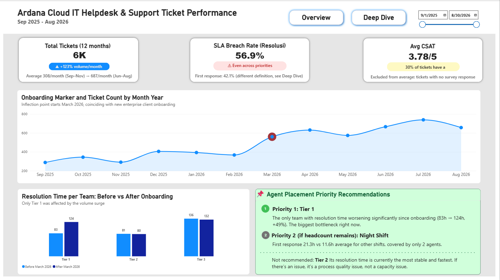
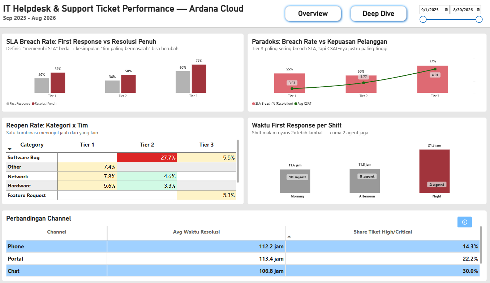

# IT Helpdesk & Support Ticket Performance: Ardana Cloud

## Business Problem
Ardana Cloud (perusahaan fiktif) mengalami lonjakan volume tiket support pasca onboarding klien enterprise baru. Leadership perlu tahu tim atau shift mana yang paling terdampak, apakah SLA breach yang tinggi benar-benar berkorelasi dengan kepuasan pelanggan yang rendah, dan kalau cuma disetujui tambahan 3 headcount tahun ini, ke mana sebaiknya diarahkan.

## Screenshot / Demo
**Overview**


**Deep Dive**


## Approach
- Star schema: `fact_tickets` + dimensi `dim_agents`, `dim_category`, `dim_sla`, `Dim_Date`
- Data cleaning: dedup baris migrasi sistem, standardisasi kategori tiket, fix bug timezone, exclude tiket tanpa respon survei dari rata-rata CSAT
- DAX time intelligence buat bandingkan performa sebelum vs sesudah onboarding (Maret 2026)
- Dua definisi SLA breach dihitung paralel (first response vs resolusi penuh) untuk uji apakah kesimpulan "tim paling bermasalah" berubah tergantung definisi

## Key Findings & Business Impact
- Volume tiket naik **123%** (308/bulan → 687/bulan) sejak onboarding klien enterprise Maret 2026
- SLA Breach Rate keseluruhan **56.9%**, merata di semua level prioritas. Masalahnya sistemik, bukan satu prioritas tertentu
- **Tier 1** satu-satunya tim dengan waktu resolusi memburuk signifikan sejak onboarding (83j ke 124j, naik 49%), bottleneck utama saat ini
- Paradoks: **Tier 3** paling sering breach SLA (77%) tapi CSAT-nya justru paling tinggi (4.01/5). Breach rate tinggi tidak otomatis berarti pelanggan tidak puas
- Shift malam: first response **21.3 jam** vs rata-rata 11.7 jam shift lain, cuma dijaga 2 agent
- Kombinasi Software Bug × Tier 2 punya reopen rate jauh di atas kombinasi lain (27.7%)
- **Rekomendasi 3 headcount**: prioritaskan Tier 1 (kapasitas), lalu shift malam. Tier 2 tidak direkomendasikan karena paling stabil dan cepat saat ini, kalau ada masalah di situ sifatnya kualitas proses, bukan kapasitas

## Fitur Dashboard
- 2 halaman: **Overview** (kondisi umum + rekomendasi headcount) dan **Deep Dive** (diagnostik akar masalah)
- Slicer tanggal per halaman, sengaja tidak disinkronkan (tujuan analisis beda)
- KPI card dengan conditional formatting, ambang batas berbasis sebaran data asli
- Edit Interactions dikonfigurasi manual supaya klik antar visual tidak mengubah temuan yang dimaksudkan tetap (anti-misleading)

## Struktur Repo
```
report/   → file .pbix
data/     → data mentah (fact_tickets.csv, dim_agents.csv, dim_category.csv, dim_sla.csv)
images/   → screenshot dashboard
```

## Cara Membuka
Download file dari folder `/report`, buka pakai Power BI Desktop versi terbaru.

---

**Catatan:** Dataset ini adalah data simulasi, dibuat untuk keperluan portofolio, dirancang menyerupai pola bisnis IT helpdesk/support agar analisisnya realistis. Bukan data perusahaan asli.
